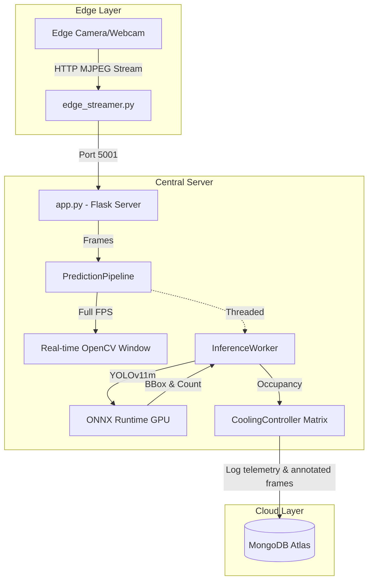

<div align="center">

# Smart Cooling Edge AI

**Intelligent, real-time classroom occupancy detection and automated HVAC energy management at the Edge.**

[](https://python.org)
[](https://opencv.org/)
[](https://onnxruntime.ai/)
[](https://ultralytics.com/)
[](https://www.mongodb.com/)
[](https://flask.palletsprojects.com/)

</div>

---

## Project Overview

**Smart Cooling Edge AI** is a lightweight, high-performance edge computing solution designed to optimize HVAC energy consumption in smart classrooms and auditoriums. By utilizing a "Thin Edge" architecture, the system captures real-time video feeds, performs rapid AI inference using **YOLOv11 ONNX Runtime**, and dynamically regulates AC units (temperature, fan speed, louver position) based on occupancy brackets. 

---

### What is HVAC?
**HVAC** stands for **Heating, Ventilation, and Air Conditioning**. In the context of this project, it refers to the automated control systems (such as air conditioners, fan speeds, and louvers) managed dynamically based on real-time classroom occupancy to maximize energy efficiency and comfort.


All telemetry and metadata are securely logged to **MongoDB Atlas** to establish a **data flywheel** enabling **long-term analytics, future ML-driven predictive control (such as anticipating occupancy trends), and environmental footprint auditing**.

---

## Features

- **Asynchronous High-Performance Inference:** Dedicated threading for YOLOv11 ONNX inference prevents blocking the video feed, resulting in ultra-smooth real-time display (30+ FPS) while maintaining robust detection.
- **Adaptive Image Enhancement:** Automatic CLAHE brightness adjustment for dark, shadowed, or poorly lit environments.
- **Intelligent HVAC Automation:** Matrix-based rule engine dynamically regulates up to 4 AC units according to live student count.
- **Cloud Telemetry Logging:** Push structured occupancy and climate control data directly to MongoDB Atlas.
- **Thin Edge Architecture:** Designed to capture streams via edge nodes and process centrally.

---

## System Architecture



---

## MLOps Practices Usage

This project strictly adheres to core **MLOps (Machine Learning Operations)** standards to ensure scalability, maintainability, and high performance in production:

- **Model Optimization:** Transitioned from raw PyTorch models to **ONNX Runtime**, providing faster, hardware-agnostic inference on edge CPU/GPUs.
- **Configuration Management:** Centralized all logic thresholds (NMS, confidence) and HVAC automation rules in `params.yaml`. This avoids hard-coded values and enables reproducible model tracking.
- **Data Flywheel / Experiment Tracking:** Continuous logging of telemetry data and annotated images to **MongoDB Atlas**. This establishes a robust data pipeline for future model retraining, drift analysis, and dashboarding.
- **Decoupled Architecture:** Utilizes a producer-consumer threading model to completely separate IO-bound stream display from the compute-bound YOLO inference, maximizing real-time FPS.
- **Secure Secrets Management:** Use of `.env` files ensures no database credentials or API keys are committed to version control.
- **Standardized Python Packaging:** Uses `setup.py` and `requirements.txt` to register the local package (`Smart_cooling_edge_AI`), ensuring clean imports and modularity.

---

## Project Structure

```text
Smart-cooling-edge_AI/
├── Smart_cooling_edge_AI/         # Core Application Package
│   ├── components/                # Inference and Cooling logic
│   ├── dbdata_access/             # MongoDB Atlas connection & logging
│   ├── logging/                   # Custom logger configurations
│   ├── pipeline/                  # Asynchronous Inference Worker & Pipeline
│   │   ├── inference_thread.py    # Background YOLO daemon thread
│   │   └── prediction_pipeline.py # Main UI and execution loop
│   └── utils/                     # CLAHE preprocessing, bounding box drawing, YAML parsers
├── models/                        # Pretrained models (.onnx)
├── notebooks/                     # Jupyter notebooks for experiments
├── templates/                     # HTML templates for Flask UI (app.py)
├── Frame_captures/                # Captured frames with detections saved here (for future analysis and model retraining)
├── logs/                          # System execution logs
├── resources/                     # Additional project assets (Videos, Images, etc.)
├── app.py                         # Flask Backend 
├── edge_streamer.py               # Edge Node Script (Camera capture & stream)
├── demo.py                        # Quick standalone demonstration script
├── template.py                    # Project structure builder script
├── setup.py                       # Package installation script
├── requirements.txt               # Python dependencies
├── params.yaml                    # Global Config parameters (Thresholds, HVAC Rules)
├── Dockerfile                     # Containerization instructions
├── .gitignore                     
└── .env                           # Environment variables 
```

---

## ⚙️ Prerequisites

Before setting up the project, ensure you have the following installed:

* **Python 3.10+**
* **NVIDIA GPU drivers & CUDA toolkit** (Optional but highly recommended for `onnxruntime-gpu`)
* An active **MongoDB Atlas** cluster connection string.
* A connected webcam or video source (e.g., IP Camera).

---

## Installation & Setup

### 1. Clone the Repository
```bash
git clone https://github.com/your-username/Smart-cooling-edge_AI.git
cd Smart-cooling-edge_AI
```

### 2. Create Virtual Environment
```bash
# Windows
python -m venv acvenv
acvenv\Scripts\activate

# macOS / Linux
python3 -m venv acvenv
source acvenv/bin/activate
```

### 3. Install Dependencies
Install the core package in editable mode:
```bash
pip install -e .
```

### 4. Configuration
Create a `.env` file in the root directory and add your MongoDB credentials:
```env
MONGODB_URI="mongodb+srv://<user>:<password>@cluster0.mongodb.net/?retryWrites=true&w=majority"
DB_NAME="Edge_AI_Smart_Cooling"
COLLECTION_NAME="Edge_AI_Smart_Cooling_Logs"
```
> Adjust inference thresholds and HVAC automation rules in `params.yaml`.

---

## Running the Application

### Option A: Local / Integrated Testing
To run the full prediction pipeline locally with OpenCV window display:
```bash
python -c "from Smart_cooling_edge_AI.pipeline.prediction_pipeline import PredictionPipeline; PredictionPipeline().run_pipeline()"
```

### Option B: Distributed Edge Architecture (Production)
1. **Start the Edge Streamer (on the camera node):**
   ```bash
   python edge_streamer.py
   ```
2. **Start the Central Server:**
   ```bash
   python app.py
   ```

---

## Automation Rules (Matrix)

The HVAC system adjusts automatically based on the following default occupancy brackets (configurable in `params.yaml`):

| Occupancy Level | Student Count | Active ACs | Mode | Target Temp | Fan Speed | Louver |
| :--- | :--- | :--- | :--- | :--- | :--- | :--- |
| **Low** | 0 - 20 | 2 | Alternate | 24°C - 25°C | Low | Down |
| **Medium** | 21 - 60 | 4 | Normal | 22°C - 23°C | Medium | Swing |
| **High** | 61 - 110 | 4 | Active | 20°C - 21°C | High | Horizontal |
| **Full** | 111 - 150 | 4 | Turbo | 17°C - 19°C | Max | All Swing |

---

## Troubleshooting

- **Double Inference/Lag:** The system has been upgraded to a threaded architecture. If lag persists, ensure you are utilizing the GPU (`onnxruntime-gpu` is installed) and check CPU/GPU utilization.
- **MongoDB Timeout:** Verify your IP address is whitelisted in MongoDB Atlas and that `certifi` is installed.
- **Camera Not Opening:** Check your device index in `params.yaml` (`PIPELINE_CONFIG.video_source`). Change `0` to your specific camera ID or RTSP URL.

---

### Contributing

Contributions, issues, and feature requests are welcome! If you want to help improve or scale this system, check out the key areas for contribution:

- ML Training Pipeline: Build automated data extraction pipelines using MongoDB telemetry logs to prepare custom training datasets.

- Model Retraining & Fine-Tuning: Fine-tune and retrain the default YOLO models using domain-specific classroom capture datasets for higher inference accuracy.

- System Optimization: Optimize multi-threading performance, edge stream latency, and ONNX runtime execution speeds.

#### How to contribute

- Fork the Project

- Create your Feature Branch (git checkout -b feature/ bla.. bla... bla...)

- Commit your Changes (git commit -m 'Add some bla.. bla... bla...')

- Push to the Branch (git push origin feature/ bla.. bla... bla...)

- Open a Pull Request

---

### Author

#### Pasindu Gunathilake

- Education: BSc. Computer Science Undergraduate at the University of Jaffna, Sri Lanka.
- Email: [pasindugunatilake144@gmail.com](mailto:pasindugunatilake144@gmail.com)
- Web: [https://pasindugunathilake.github.io/Portfolio-PG](https://pasindugunathilake.github.io/Portfolio-PG)
- Focus: Full-Stack Development, AI/ML(with Deep Learning) Systems, RAG Systems and Architectures.

---

## License

This project is developed for educational & research purposes. 